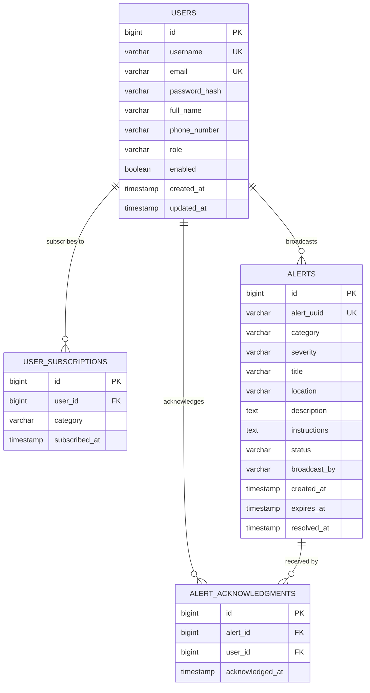

# 🚨 Emergency Alert System (EAS) — Cloud Edition

[](https://www.oracle.com/java/)
[](https://spring.io/projects/spring-boot)
[](https://www.mysql.com/)
[](https://aws.amazon.com/)
[](LICENSE)

> [!WARNING]
> **SAFETY & LEGAL DISCLAIMER: EDUCATIONAL & SIMULATION DEMONSTRATION ONLY**  
> This application is built strictly for educational, academic, and lab demonstration purposes. It is **NOT** connected to official municipal, state, or federal government emergency warning systems (e.g., FEMA Integrated Public Alert and Warning System [IPAWS], Wireless Emergency Alerts [WEA], Emergency Alert System [EAS], or 911 dispatch centers). Do not use this software as an authoritative source of life safety information during real-world hazards.

---

## 📋 Table of Contents
1. [System Overview & Architecture](#-system-overview--architecture)
2. [Key Capabilities & Hazards Covered](#-key-capabilities--hazards-covered)
3. [Database Schema & Data Dictionary](#-database-schema--data-dictionary)
4. [Real-Time WebSocket & STOMP Protocol](#-real-time-websocket--stomp-protocol)
5. [Security & Role-Based Access Control](#-security--role-based-access-control)
6. [Local Quickstart & Execution](#-local-quickstart--execution)
7. [AWS Production Deployment](#-aws-production-deployment)
8. [Automated Testing & Quality Assurance](#-automated-testing--quality-assurance)
9. [API Reference Specification](#-api-reference-specification)

---

## 🏛 System Overview & Architecture

The Emergency Alert System is a distributed, event-driven web application designed to broadcast real-time hazard warnings to citizens and emergency managers. The architecture leverages **Java Spring Boot 3**, **Spring Security with JWT**, **Spring WebSocket with STOMP messaging**, and **MySQL 8.0** on **Amazon Web Services (AWS)**.

### Architecture Diagram

```mermaid
graph TD
    subgraph Client Tier [Browser & Mobile Clients]
        AdminUI["🛡️ Admin Command Center (Web)"]
        UserUI["📱 Citizen Web Portal (HTML5/CSS3/JS)"]
    end

    subgraph AWS Cloud Infrastructure
        subgraph Public Subnet
            ALB["Application Load Balancer (ALB)<br/>SSL/TLS Termination (ACM) + WSS"]
        end

        subgraph Private Subnet 1 [Application Compute]
            App["Spring Boot 3 App Container<br/>(ECS Fargate / EC2 / Beanstalk)<br/>Port: 8080"]
            WSBroker["In-Memory STOMP Broker<br/>/topic/alerts/* & /user/queue/*"]
        end

        subgraph Private Subnet 2 [Database Layer]
            RDS[("Amazon RDS MySQL 8.0<br/>Multi-AZ Instance<br/>Port: 3306")]
        end
    end

    AdminUI -->|REST API (HTTPS Bearer JWT)| ALB
    UserUI -->|REST API (HTTPS Bearer JWT)| ALB
    UserUI <==>|Persistent WebSocket (WSS)| ALB
    AdminUI <==>|Persistent WebSocket (WSS)| ALB

    ALB -->|HTTP Port 8080| App
    ALB <==>|Upgraded WebSocket| App
    App -->|HikariCP JDBC Connection Pool| RDS
    App --> WSBroker
```

---

## 🔥 Key Capabilities & Hazards Covered

The system supports category-based subscriptions and routing across four core hazard vectors:

| Category | Icon | Scope & Description | Default Action Guidance |
| :--- | :---: | :--- | :--- |
| **FIRE** | 🔥 | Wildfires, structural blazes, chemical fires, rapid vegetation burns | Immediate evacuation routes, emergency shelter locations |
| **FLOOD** | 🌊 | Flash flooding, river cresting, dam spillway warnings, storm surge | Move to higher ground; "Turn Around, Don't Drown" notices |
| **EARTHQUAKE**| 🌋 | Seismic shocks, tremors, aftershocks, fault displacement | Drop, Cover, and Hold On; gas line shut-off precautions |
| **SECURITY** | 🛡️ | Hazardous spills, civil security cordons, industrial containment | Shelter in place, lock exterior doors, close ventilation |

### Severity Levels
- **CRITICAL**: Immediate threat to life or property. Pulsating red visual banner, high-urgency siren synthesis tone via Web Audio API.
- **HIGH**: Serious hazard condition. Orange alert indicator, dual-tone warning chime.
- **MEDIUM**: Precautionary advisory / caution. Amber badge, single gentle chime.
- **LOW**: Informational bulletin or resolution/cancellation of a prior incident.

---

## 🗄 Database Schema & Data Dictionary

The application uses **MySQL 8.0+** with InnoDB storage engine, UTF-8 MB4 character set, and foreign key cascading.

### Entity Relationship Diagram



The schema is codified in [`schema.sql`](file:///c:/Users/dsnpi/OneDrive/Desktop/CC_Lab/schema.sql) and seed data in [`data.sql`](file:///c:/Users/dsnpi/OneDrive/Desktop/CC_Lab/data.sql).

---

## ⚡ Real-Time WebSocket & STOMP Protocol

The application provides real-time bidirectional push updates over WebSockets using the **STOMP (Simple Text Oriented Messaging Protocol)**:

### 1. Endpoints
- **Web Browser Client**: `/ws-alerts` (Supports SockJS protocol fallback)
- **Native / Mobile / IoT Client**: `/ws-alerts-native` (Standard RFC 6455 WebSocket)

### 2. Message Channels
- `/topic/alerts/all` — Global broadcast channel for all connected clients.
- `/topic/alerts/{CATEGORY}` — Hazard-specific broadcast channels:
  - `/topic/alerts/FIRE`
  - `/topic/alerts/FLOOD`
  - `/topic/alerts/EARTHQUAKE`
  - `/topic/alerts/SECURITY`
- `/user/queue/notifications` — Directed queue delivering alerts tailored to the logged-in user's subscription preferences.
- `/app/ack` — Client-to-server destination to acknowledge alert receipt.

### Sample WebSocket Alert JSON Payload
```json
{
  "id": 1,
  "alertUuid": "ALERT-FIRE-1001",
  "category": "FIRE",
  "severity": "CRITICAL",
  "title": "Wildfire Immediate Evacuation Order - Sector North",
  "location": "North Ridge Canyon, Zone 4",
  "description": "A fast-moving vegetation fire has broken out near North Ridge Canyon, driven by 35mph dry winds.",
  "instructions": "Evacuate immediately toward South Highway corridor. Assemble at Community Shelter #2.",
  "status": "ACTIVE",
  "broadcastBy": "admin",
  "createdAt": "2026-11-16T07:15:00",
  "expiresAt": "2026-11-16T11:15:00",
  "resolvedAt": null
}
```

---

## 🔒 Security & Role-Based Access Control

1. **Password Hashing**: Uses `BCryptPasswordEncoder` with standard cost factor 10. Passwords are never stored in plain text.
2. **Stateless JWT Authentication**: Signed with HMAC-SHA256 (`Keys.hmacShaKeyFor`) with configurable expiration (default 24h).
3. **Role-Based Authorization**:
   - `ROLE_ADMIN`: Authorized to create/broadcast new alerts, resolve alerts, revoke alerts, and inspect system audit statistics.
   - `ROLE_USER`: Authorized to manage category subscriptions, acknowledge alerts, and fetch personalized feeds.
   - `Public`: Allowed to view the active feed, subscribe to WebSocket feeds, login, and register.
4. **Input Validation**: Jakarta Bean Validation (`@Valid`, `@NotBlank`, `@Size`, `@Email`, `@Pattern`) guards against injection and malformed payloads.
5. **CORS & Security Headers**: Tight Content-Security-Policy, X-Frame-Options (`SAMEORIGIN`), and X-Content-Type-Options (`nosniff`).

---

## 🚀 Local Quickstart & Execution

### Prerequisites
- Java 21 LTS (or Java 17+)
- Maven 3.9+ (or included `./mvnw` / `mvnw.cmd`)
- (Optional) Docker & Docker Compose

### Option A: Run with Docker Compose (Recommended - Instant MySQL + App)
```bash
# Clone or navigate to project directory
cd c:\Users\dsnpi\OneDrive\Desktop\CC_Lab

# Start both MySQL 8.0 and Spring Boot App in containers
docker-compose up --build
```
Open your browser to: **`http://localhost:8080`**

### Option B: Run Spring Boot Locally
```bash
# Set your MySQL environment variables (or rely on defaults in application-dev.yml)
export DB_HOST=localhost
export DB_PORT=3306
export DB_NAME=emergency_db
export DB_USERNAME=root
export DB_PASSWORD=your_mysql_password

# Run Spring Boot
mvn spring-boot:run
```

### Pre-Seeded Default Accounts:
| Role | Username | Password | Default Subscriptions |
| :--- | :--- | :--- | :--- |
| **Administrator** | `admin` | `Admin@12345` | Master broadcast privileges |
| **Citizen User** | `citizen` | `User@12345` | FIRE, FLOOD, EARTHQUAKE |

---

## ☁️ AWS Production Deployment

### 1. Architecture On AWS
- **Networking**: VPC with 2 Public Subnets (AZ-a, AZ-b) and 2 Private Subnets (AZ-a, AZ-b).
- **Load Balancing**: AWS Application Load Balancer (ALB) with sticky sessions enabled for WebSocket connections and SSL/TLS termination via AWS Certificate Manager (ACM).
- **Compute Layer**: Amazon ECS Fargate Task or Amazon EC2 instance running the multi-stage Docker container.
- **Data Layer**: Amazon RDS MySQL 8.0 Multi-AZ deployed in private subnets with automated backup and storage encryption.

### 2. Infrastructure as Code (CloudFormation)
Deploy the complete AWS stack in one command using the provided [`aws/cloudformation-template.yml`](file:///c:/Users/dsnpi/OneDrive/Desktop/CC_Lab/aws/cloudformation-template.yml):

```bash
aws cloudformation create-stack \
  --stack-name emergency-alert-production \
  --template-body file://aws/cloudformation-template.yml \
  --parameters \
      ParameterKey=EnvironmentName,ParameterValue=emergency-prod \
      ParameterKey=DbUsername,ParameterValue=dbadmin \
      ParameterKey=DbPassword,ParameterValue="StrongRDSMasterPassword2026!" \
      ParameterKey=JwtSecret,ParameterValue="ProductionHMACSecretKeyWithAtLeast256BitsLengthMustBeKeptSecret!" \
  --capabilities CAPABILITY_IAM
```

### 3. Deploying with AWS Elastic Beanstalk
1. Package the repository or container definition:
   ```bash
   zip -r emergency-alert-eb.zip Dockerfile src pom.xml aws/Dockerrun.aws.json .ebextensions
   ```
2. Create an Elastic Beanstalk Web Application environment selecting **Docker running on 64bit Amazon Linux 2023**.
3. Attach an Amazon RDS MySQL database in the environment configuration or pass the RDS endpoint via environment variables:
   - `SPRING_PROFILES_ACTIVE`: `prod`
   - `DB_HOST`: `<your-rds-endpoint>.rds.amazonaws.com`
   - `DB_NAME`: `emergency_db`
   - `DB_USERNAME`: `<your-rds-username>`
   - `DB_PASSWORD`: `<your-rds-password>`
   - `JWT_SECRET`: `<your-256-bit-secret>`

### 4. WebSocket & HTTPS Configuration (ALB / Nginx)
When hosting behind an AWS Application Load Balancer or Nginx reverse proxy:
- Ensure **WebSocket upgrade headers** are forwarded:
  ```nginx
  proxy_set_header Upgrade $http_upgrade;
  proxy_set_header Connection "upgrade";
  ```
- Target group **stickiness** must be enabled on the ALB (`stickiness.enabled=true`, `stickiness.type=lb_cookie`) to maintain session affinity during SockJS HTTP fallbacks.
- Refer to [`aws/nginx-ssl.conf`](file:///c:/Users/dsnpi/OneDrive/Desktop/CC_Lab/aws/nginx-ssl.conf) for production SSL/TLS termination and hardened security headers.

---

## 🧪 Automated Testing & Quality Assurance

The codebase includes automated tests covering services, authentication, password security, and REST controllers:

- [`EmergencyAlertSystemApplicationTests.java`](file:///c:/Users/dsnpi/OneDrive/Desktop/CC_Lab/src/test/java/com/emergency/alert/EmergencyAlertSystemApplicationTests.java) — Spring context initialization verification.
- [`PasswordHashingTest.java`](file:///c:/Users/dsnpi/OneDrive/Desktop/CC_Lab/src/test/java/com/emergency/alert/security/PasswordHashingTest.java) — BCrypt password hashing, salting, and verification.
- [`SubscriptionServiceTest.java`](file:///c:/Users/dsnpi/OneDrive/Desktop/CC_Lab/src/test/java/com/emergency/alert/service/SubscriptionServiceTest.java) — Subscription lifecycle for FIRE, FLOOD, EARTHQUAKE, SECURITY.
- [`AlertServiceTest.java`](file:///c:/Users/dsnpi/OneDrive/Desktop/CC_Lab/src/test/java/com/emergency/alert/service/AlertServiceTest.java) — Alert broadcast, UUID assignment, and resolution.
- [`AuthControllerTest.java`](file:///c:/Users/dsnpi/OneDrive/Desktop/CC_Lab/src/test/java/com/emergency/alert/controller/AuthControllerTest.java) — Registration, JWT issuance, and authentication failure checks.

### Running Tests Locally:
```bash
mvn test
```

---

## 📖 API Reference Specification

### Authentication & Profiles
| Method | Endpoint | Access | Description |
| :--- | :--- | :--- | :--- |
| `POST` | `/api/auth/register` | Public | Register new citizen user account |
| `POST` | `/api/auth/login` | Public | Authenticate and obtain JWT Bearer token |

### Citizen Subscriptions & Alerts
| Method | Endpoint | Access | Description |
| :--- | :--- | :--- | :--- |
| `GET` | `/api/public/alerts` | Public | List active emergency alerts |
| `GET` | `/api/public/alerts/category/{category}` | Public | List active alerts filtered by category |
| `GET` | `/api/public/stats` | Public | System status and active alert statistics |
| `GET` | `/api/subscriptions` | User/Admin | Retrieve authenticated user's subscriptions |
| `PUT` | `/api/subscriptions` | User/Admin | Update user's category subscriptions |
| `GET` | `/api/user/alerts` | User/Admin | Get active alerts matching user's subscriptions |

### Admin Incident Operations
| Method | Endpoint | Access | Description |
| :--- | :--- | :--- | :--- |
| `POST` | `/api/admin/alerts` | `ROLE_ADMIN` | Authorize and broadcast new alert |
| `PUT` | `/api/admin/alerts/{id}/resolve` | `ROLE_ADMIN` | Mark alert as RESOLVED and broadcast update |
| `PUT` | `/api/admin/alerts/{id}/cancel` | `ROLE_ADMIN` | Revoke / Cancel alert and broadcast update |
| `GET` | `/api/admin/alerts` | `ROLE_ADMIN` | Full alert archive (active, resolved, cancelled) |
| `GET` | `/api/admin/stats` | `ROLE_ADMIN` | Comprehensive subscriber and system metrics |
